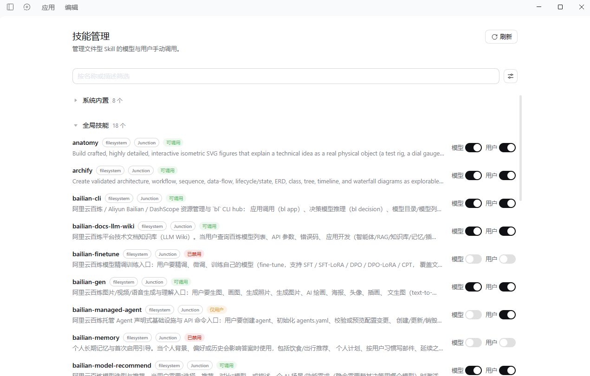

# DSH Skills Management

English | [简体中文](README.zh-CN.md)

A DeepSeek Harness (DSH) Skill catalog and invocation-policy plugin. Skills from every Provider remain visible, while file-backed Skills support independent model and user manual invocation controls. The plugin reads current source files without modifying `SKILL.md`, frontmatter, references, scripts, Junctions, or Git workspaces.

Repository: <https://github.com/JayC-L/dsh-skills-management>

## UI preview



## Features

- **Two channels for file-backed Skills**: control model invocation and user manual invocation (`/name`) independently.
- **Live source reads**: refresh frontmatter when the catalog is recomputed and read the current body on every invocation.
- **Original resource locations**: references, scripts, and other resources remain in the source Skill directory instead of being copied into policy data.
- **Complete catalog**: in-memory, remote, and dynamic Providers remain visible but read-only; the Host rejects policy changes for them as well.
- **Missing-policy cleanup**: when a file-backed Skill disappears, its row shows a native delete button that removes only the policy record.
- **Native DSH UI**: shared Button, Input, Tag, Switch, icons, and semantic design tokens.
- **One global view**: aggregates the DSH Registry, filesystem, and Agent scopes without per-session policy controls.

## Requirements

- DSH `>=0.2.1-rc.5 <0.3.0-0`.
- Verified with DSH `0.2.2-rc.1`, Cordis `4.1.0`, and the Desktop Profile.
- The browser client uses the DSH ModuleLoader and native UI primitives; it does not bundle React.

## Installation

### Plugin package

Add this repository in the DSH plugin manager, or use the prebuilt Release package:

```text
https://github.com/JayC-L/dsh-skills-management/releases/latest/download/dsh-skills-management.tgz
```

On DSH Desktop, use the application's built-in plugin manager. After installation and activation, refresh the page and open **Skills Management** in the sidebar.

### From source

```sh
pnpm install
pnpm run check
pnpm test
pnpm pack
```

## Which Skills can be managed

A manageable Skill must meet all of these conditions:

1. It is registered with the current DSH Registry.
2. It comes from a project, user, or explicitly configured custom file directory.
3. It has a verifiable local file path.
4. Its frontmatter is valid and its declared name matches the Skill name.

Regular directories, flat Markdown files, and Junctions are supported. A file discovered on disk but not registered with DSH is not treated as a manageable invocation target.

Non-file Providers continue to supply their own catalog entries and content. This plugin does not take over, copy, or persist their bodies, and it does not infer a local path from a `source` label. These rows show **Read only**, and direct management API requests are rejected too. Bundled Provider assets are read-only even when a `SKILL.md` file exists.

## Invocation channels

User manual invocation means that a user explicitly selects a Skill with `/name`. It is independent of automatic selection by the model.

| Model | User manual | Status | Behavior |
| --- | --- | --- | --- |
| On | On | Available | Both model and user manual invocation are available |
| Off | On | User manual only | The model cannot invoke it, but `/name` remains available |
| On | Off | Model only | The model can invoke it, but user manual invocation is disabled |
| Off | Off | Disabled | Neither channel can invoke it |

Policy is global by Skill name, so same-name Skills are managed together. Restoring the original invocation defaults removes the policy record; those defaults are not necessarily both channels enabled.

Before saving a single-channel policy, the Host reads the current original definitions and compares their content, resources, and original invocation flags across scopes. Conflicting same-name definitions are rejected instead of risking the wrong content. You can explicitly disable both channels without reading or sharing same-name bodies.

## Catalog and refresh

Each row shows:

- Skill name and current description;
- Provider name;
- Source form: local file, Junction, source file, stale path, registered only, bundled resource, non-file, or missing;
- Current invocation status;
- Two switches for file-backed Skills, **Read only** for other Providers, or a delete button for missing entries.

The management catalog is requested again when:

- the page component mounts;
- a switch or delete operation succeeds;
- you click **Refresh**.

Refresh rereads policy, scans explicitly configured Skill directories, and aggregates the Registry and scopes. File-backed metadata is read when the Registry recomputes its catalog. Every `get()` reads the current body, so body updates do not require toggling a policy.

Search by name or description and combine invocation-status and source filters. Built-in groups start collapsed and expand automatically for searches and filters.

## Missing entries and deletion

A Skill is marked missing only when a complete catalog or verifiable file evidence confirms that its original definition is gone. Scope failures, incomplete Registries, and indeterminate states return an error instead of being misreported as missing.

Missing rows replace the two switches with a native **Delete** button:

- the Host scans again and confirms that the entry is still missing;
- only the corresponding policy record is removed;
- Skill source files and Junctions are never deleted;
- if the original Skill has recovered, the request returns 409 and preserves policy;
- every other policy remains unchanged.

Opening the page or performing a normal refresh never deletes policy automatically.

## Policy file

Default location:

```text
~/.dsh/skills-management/disabled.json
```

Each record contains only invocation policy and file-location metadata:

| Field | Purpose |
| --- | --- |
| `modelInvocable` | Effective model invocation state |
| `userInvocable` | Effective user manual invocation state |
| `originalInvocation` | Original defaults captured for correct restoration |
| `display` | Original description, Provider, source, and optional usage guidance |
| `liveFile` | File-backed policy marker, currently `true` |
| `sourcePath` | Current source file location |
| `sourceBase` | Resource-resolution directory |

Policy never stores Skill bodies or the contents of references and scripts. `sourcePath` and `sourceBase` are internal to the Host and are not returned by the management list API.

Writes use a serial queue, a strict disk reread before mutation, a temporary file in the same directory, `fsync`, and atomic replacement. A damaged policy may temporarily fall back to the last valid in-memory state for reads, but all writes are rejected so stale memory cannot overwrite the damaged file.

## Implementation and safety boundaries

- A low-rank policy Provider overrides invocation flags and live file definitions only for file-backed Skills. Removing policy restores the original Provider automatically.
- File-backed catalog reads use current frontmatter; invocation reads use the current body and validate its declared Skill name.
- Missing files, identity conflicts, duplicate candidates, and I/O errors are never silently replaced with other content.
- Saving a policy that needs a body temporarily removes the old overlay to read the original Provider. Capture or final-write failures roll back the old policy, but the original definition can be briefly exposed during capture.
- Management endpoints accept loopback requests only and validate the Host, Origin, method, and mutation headers.
- The plugin does not modify Skill source files, scan unrelated application directories, collect telemetry, or initiate external network requests.

Management endpoints:

```text
GET  /api/dsh-skills-management/list
POST /api/dsh-skills-management/set
```

`/set` supports `model`, `user`, and `both` channel changes, plus `action: "remove"` after a fresh missing-state check.

## Uninstall

Uninstalling disposes global and Agent-scoped policy Providers, page Slots, and management endpoints, restoring original Providers. The policy file is retained so the same file-backed policies can be applied after reinstallation. To remove it completely, restore each Skill's defaults or delete its missing policy before uninstalling.

## Tests

```sh
pnpm run check
pnpm test
```

Coverage includes independent channels, original defaults, same-name conflicts, live body and metadata reads, resource paths, flat files, Junctions, missing recovery and deletion, read-only non-file Providers, atomic writes, damaged-policy protection, the real DSH Registry, Agent scopes, and plugin teardown.

## License

[MIT](LICENSE)
