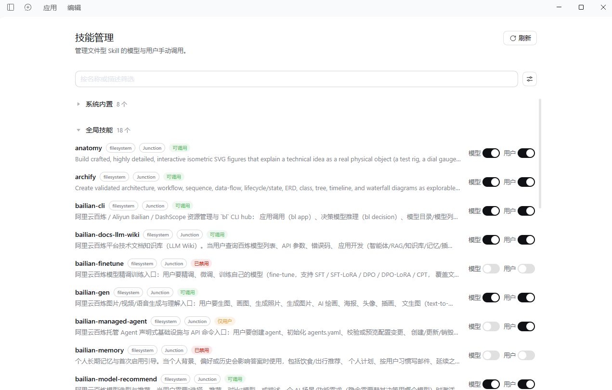

# DSH 技能管理

[English](README.md) | 简体中文

一个用于查看 DeepSeek Harness（DSH）Skill 清单并管理调用策略的插件。所有 Provider 的 Skill 都可展示；文件型 Skill 支持独立的模型调用和用户手动调用控制。插件读取当前源文件，不修改 `SKILL.md`、frontmatter、references、scripts、Junction 或 Git 工作区。

仓库：<https://github.com/JayC-L/dsh-skills-management>

## 界面预览



## 功能

- **文件型双通道管理**：分别控制模型调用和用户手动调用（`/名称`）。
- **实时源文件**：清单重新计算时读取当前 frontmatter，每次实际调用时读取当前正文。
- **保留资源位置**：references、scripts 等资源继续从原 Skill 目录解析，不复制、不打包进策略。
- **完整清单**：内存、远程和动态 Provider 也可展示，但不提供策略开关，Host 同样拒绝修改。
- **未加载策略清理**：文件型原 Skill 消失后显示“未加载”和原生删除按钮，只删除策略记录。
- **原生 DSH UI**：使用共享 Button、Input、Tag、Switch、图标和语义设计令牌。
- **全局统一视图**：汇总 DSH Registry、文件系统与各 Agent 作用域，不提供按会话分别设置。

## 运行要求

- DSH `>=0.2.1-rc.5 <0.3.0-0`。
- 已在 DSH `0.2.2-rc.1`、Cordis `4.1.0` 和 Desktop Profile 上验证。
- 浏览器客户端使用 DSH ModuleLoader 与原生 UI primitives，不单独打包 React。

## 安装

### 插件包

在 DSH 插件管理页面添加本仓库，或下载 Release 中的预构建包：

```text
https://github.com/JayC-L/dsh-skills-management/releases/latest/download/dsh-skills-management.tgz
```

DSH Desktop 请使用应用内的插件管理功能。安装并启用后，刷新页面，在左侧打开 **技能管理**。

### 从源码开发

```sh
pnpm install
pnpm run check
pnpm test
pnpm pack
```

## 哪些 Skill 可以管理

可管理项必须同时满足：

1. 已接入当前 DSH Registry；
2. 来源属于项目、用户或显式配置的自定义文件目录；
3. 具有可验证的本地文件路径；
4. 文件内容与 Skill 名称匹配，frontmatter 有效。

普通目录、平铺 Markdown 和 Junction 都支持。仅扫描到文件、但没有注册进 DSH 的条目不会被当作可调用 Skill 管理。

非文件型 Provider 继续由原 Provider 提供清单和正文。本插件不会接管、复制或保存它们的正文，也不会根据 `source` 标签猜测本地路径。页面显示“仅显示”，直接调用管理 API 同样会被拒绝。

## 双通道行为

用户手动调用是指在输入框中通过 `/名称` 主动调用 Skill；它与模型自动选择 Skill 是两条独立通道。

| 模型调用 | 用户手动调用 | 页面状态 | 效果 |
| --- | --- | --- | --- |
| 开 | 开 | 可调用 | 模型和用户手动调用均可用 |
| 关 | 开 | 仅用户 | 模型不可调用，用户手动调用仍可用 |
| 开 | 关 | 仅模型 | 模型可调用，用户手动调用已关闭 |
| 关 | 关 | 已禁用 | 两种方式均不可用 |

策略按 Skill 名称全局生效，同名 Skill 会一起管理。恢复到原始默认调用状态后，对应策略记录自动删除；原始默认状态不一定两个通道都开启。

修改单通道策略时，Host 会读取当前原定义并检查不同作用域中的正文、资源和原始调用状态。发现同名定义不一致时会拒绝保存，避免执行错误内容；可显式同时关闭两个通道，不读取或共享同名正文。

## 清单与刷新

每行显示：

- Skill 名称与当前描述；
- Provider 名称；
- 文件形态：本地文件、Junction、插件文件、注册项或未加载；
- 当前调用状态；
- 文件型双开关、非文件型“仅显示”，或未加载删除按钮。

以下操作会重新请求管理清单：

- 页面组件挂载；
- 开关或删除操作成功；
- 点击右上角“刷新”。

刷新会重新读取策略、扫描明确配置的 Skill 目录并汇总 Registry 与各作用域。文件型 Provider 在 Registry 重新计算清单时读取当前描述；每次 `get()` 都重新读取当前正文，因此正文更新不依赖重新切换开关。

支持按名称或描述搜索，并按调用状态和来源组合筛选。系统内置分组默认折叠，搜索或筛选时会自动展开。

## 未加载与删除

只有完整清单或可验证文件证据确认原 Skill 已消失时，才标记“当前未加载”。作用域采集失败、Registry 不完整或暂时无法判断时会返回错误，不会把失败误报为缺失。

未加载行不显示双开关，而显示原生“删除”按钮：

- 删除前重新扫描并确认仍未加载；
- 只删除对应的策略记录；
- 不删除 Skill 源文件或 Junction；
- 若原 Skill 已恢复，则返回 409，不删除策略；
- 其他策略保持不变。

打开页面和普通刷新不会自动删除策略。

## 策略文件

默认位置：

```text
~/.dsh/skills-management/disabled.json
```

每条记录只保存调用策略和文件定位信息：

| 字段 | 作用 |
| --- | --- |
| `modelInvocable` | 策略生效后的模型调用状态 |
| `userInvocable` | 策略生效后的用户手动调用状态 |
| `originalInvocation` | 首次设置时的原始默认状态，用于正确恢复 |
| `display` | 原始描述、Provider、来源和可选适用场景 |
| `liveFile` | 文件型策略标记，当前为 `true` |
| `sourcePath` | 当前源文件位置 |
| `sourceBase` | 资源解析目录 |

策略中不保存 Skill 正文，也不保存 references 或 scripts 的内容。`sourcePath`、`sourceBase` 仅供 Host 使用，管理列表 API 不返回这些路径。

写入使用串行队列、写入前严格重读、同目录临时文件、`fsync` 和原子替换。运行中遇到损坏策略时可暂时沿用最后一次有效状态，但任何写入都会被拒绝，避免用旧内存覆盖损坏文件。

## 实现与安全边界

- 注册低 rank 策略 Provider，只覆盖文件型 Skill 的调用标志和实时文件定义；删除策略后，原 Provider 自动恢复。
- 文件型清单读取当前 frontmatter，实际调用读取当前正文，并校验 frontmatter 中的名称。
- 文件缺失、身份冲突、重复候选或 I/O 错误不会被静默替换为其他内容。
- 设置需要正文的策略时会临时移除旧覆盖以读取原 Provider；抓取或最终写入失败会回滚旧策略，但抓取期间存在短暂的原始定义暴露窗口。
- 管理接口仅接受本机回环请求，并校验 Host、Origin、请求方法和修改请求头。
- 插件不修改 Skill 源文件，不扫描无关应用目录，不收集遥测，也不主动发起外部网络请求。

管理接口：

```text
GET  /api/dsh-skills-management/list
POST /api/dsh-skills-management/set
```

`/set` 支持 `model`、`user`、`both` 通道修改，以及经过再次缺失确认的 `action: "remove"` 策略删除。

## 卸载

卸载插件会注销全局和 Agent 作用域中的策略 Provider、页面 Slot 与管理接口，原 Provider 随即恢复。策略文件默认保留，重新安装后可继续应用相同文件型策略；如需彻底清除，请在卸载前恢复各项默认状态或删除对应未加载策略。

## 测试

```sh
pnpm run check
pnpm test
```

测试覆盖双通道、原始默认状态、同名冲突、实时正文与描述、资源路径、平铺文件、Junction、缺失恢复与删除、非文件型只读、原子写入、损坏策略保护、真实 DSH Registry、Agent 作用域和插件卸载。

## 许可证

[MIT](LICENSE)
